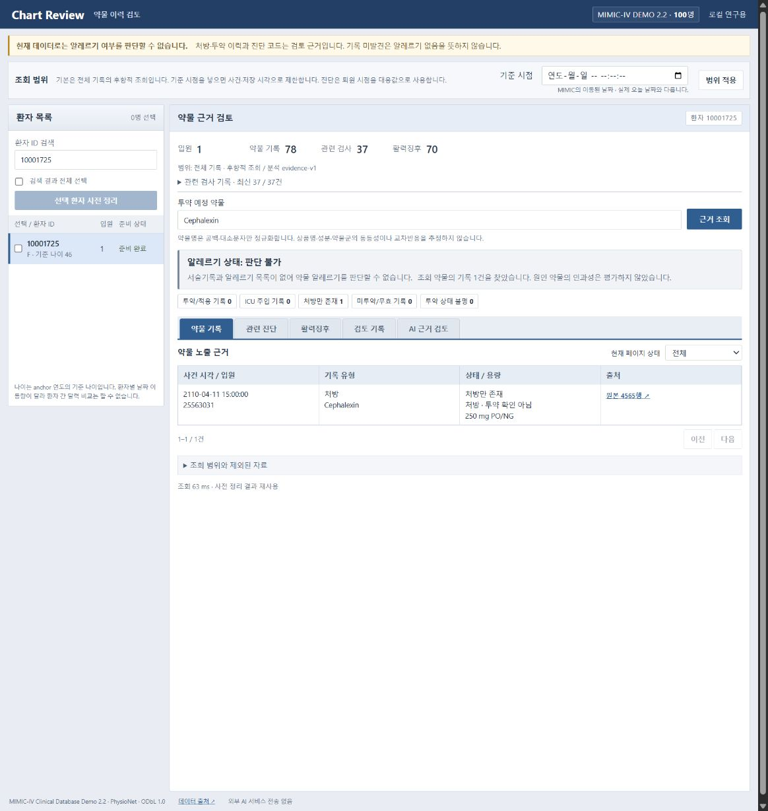
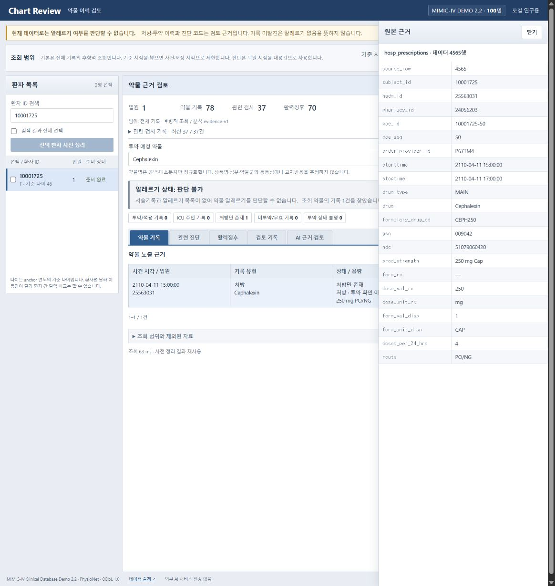
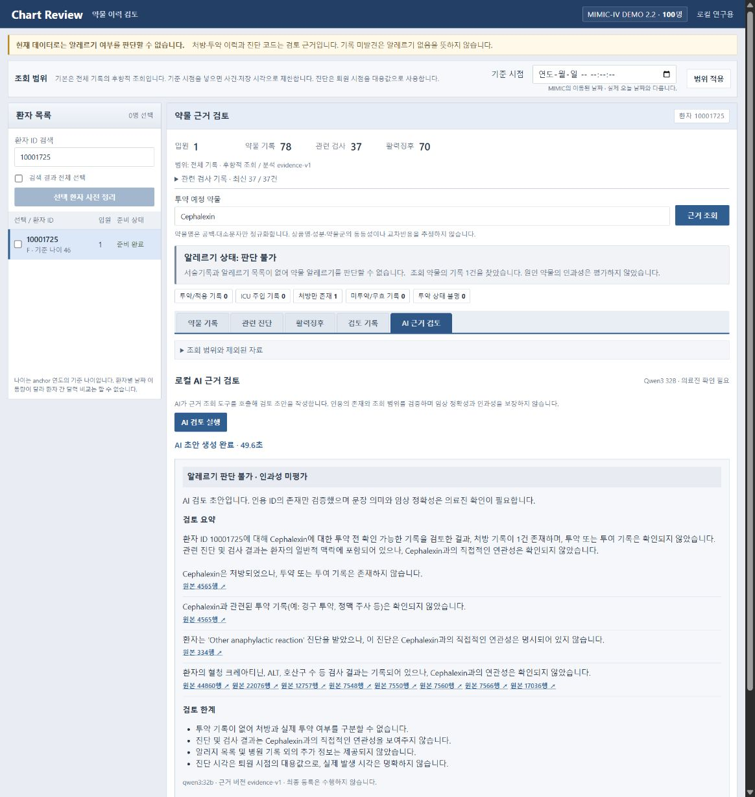
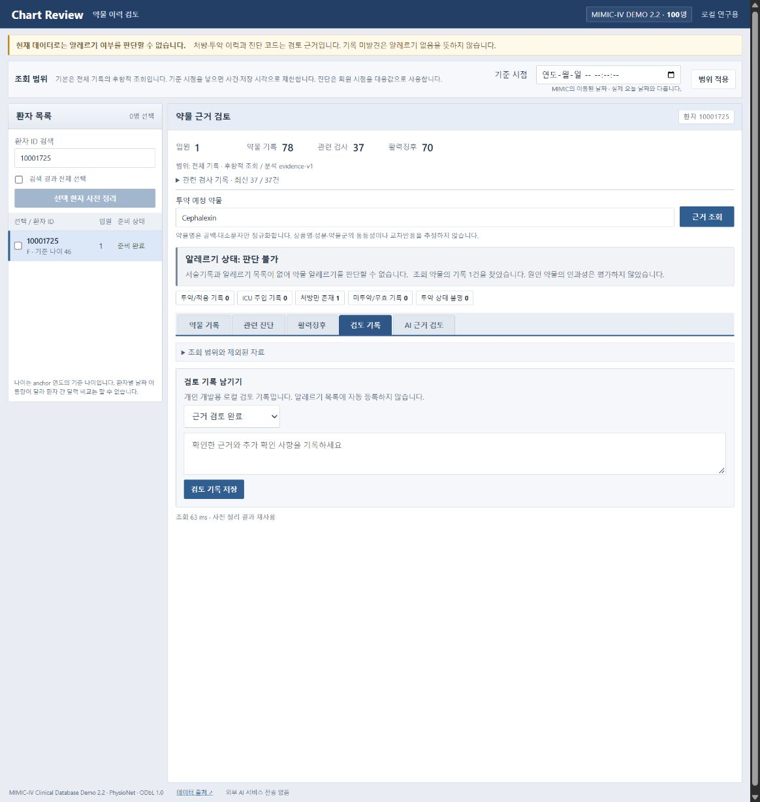

# 약물 이력 근거 검토

MIMIC-IV Clinical Database Demo 2.2로 만든 로컬 개발용 첫 버전입니다. 환자를 선택해 기록을 사전 계산하고, 약물별 근거와 환자의 진단·검사·활력징후 맥락을 원본 행까지 확인합니다. 구조화된 기록 조회 도구에 로컬 Qwen3 32B 에이전트를 연결해 근거 인용이 붙은 의료진 검토 초안을 생성합니다.



> 스크린샷은 공개 MIMIC-IV Demo로 실행한 실제 앱 화면입니다. AI 화면은 실제 로컬 Qwen 응답이며, 표시된 문장의 임상 정확성을 보장하는 예시는 아닙니다. 알레르기 판단·원인 약물 확정·자동 Alert 등록 기능은 제공하지 않습니다.

**주요 기능:** 선택 환자 사전 처리와 캐시 · 약물별 처방/투약 기록 구분 · 진단/검사/활력징후 맥락 조회 · 원본 행 추적 · 로컬 AI 도구 호출 · 의료진 검토 기록 저장.

**안내:** [처음 설치](#처음-설치) · [화면 사용 방법](#화면-사용-방법) · [기준 시점](#기준-시점으로-조회하기) · [오류 대응](#문제-해결) · [로컬 모델](#로컬-모델과-에이전트) · [데이터와 한계](#데모-데이터).

## 처음 설치

### 1. 실행 환경 준비

현재 실행 스크립트는 **Windows / PowerShell** 기준입니다. Python 3.10 이상과 Git을 준비합니다. 외부 Python 패키지나 API 키는 필요하지 않습니다. Node.js는 JavaScript 문법 검사에만 사용하며 앱 실행에는 필요하지 않습니다.

Qwen 모델 파일은 약 20.2GB이고 런타임·다운로드 ZIP·데이터·DB가 추가 공간을 사용합니다. 설치 전 **여유 디스크 공간 40GB 이상**을 권장합니다. 검증한 장비는 RAM 약 32GB, RTX 3090 Ti이며 GPU 한 장에 모델 전체를 배치했습니다. 이는 검증 환경으로, 모든 장비의 최소 사양을 의미하지 않습니다. VRAM이 부족하면 CPU 처리나 메모리 이동으로 훨씬 느려질 수 있습니다.

### 2. 저장소 받기

```powershell
git clone https://github.com/Oerets/medication-evidence-agent.git
cd medication-evidence-agent
```

GitHub의 **Code → Download ZIP**으로 받은 경우에도 압축을 푼 저장소 폴더에서 이후 명령을 실행합니다.

### 3. 데모 데이터 배치

[PhysioNet의 MIMIC-IV Demo 2.2](https://physionet.org/content/mimic-iv-demo/2.2/)에서 ZIP을 별도로 받습니다. 데이터셋과 모델 파일은 이 저장소에 포함되어 있지 않습니다. 받은 ZIP을 다음 위치에 압축 해제합니다.

```text
medication-evidence-agent/
  config.json
  data/
    raw/
      mimic-iv-clinical-database-demo-2.2/
        SHA256SUMS.txt
        hosp/
        icu/
```

예를 들어 ZIP이 다운로드 폴더에 있다면 다음과 같이 실행합니다.

```powershell
New-Item -ItemType Directory -Force -Path data/raw | Out-Null
Expand-Archive -LiteralPath "$env:USERPROFILE\Downloads\mimic-iv-clinical-database-demo-2.2.zip" -DestinationPath data/raw
```

압축 해제 후 `config.json`의 `raw_dir`와 실제 데이터 폴더가 일치하는지 확인합니다. 중첩 폴더가 생겼다면 실제 `hosp`와 `icu`가 있는 폴더를 지정합니다. 원본 CSV와 무결성 목록은 수정하지 않습니다.

### 4. 로컬 Qwen 설치

```powershell
.\setup_model.ps1
```

공식 Ollama 런타임을 다운로드하고 SHA256을 검증한 뒤 `qwen3:32b`를 받습니다. 최초 설치에는 인터넷과 시간이 필요합니다. 런타임은 `work/runtime/ollama/`, 모델은 `data/models/`에 저장됩니다. 이미 설치한 이 작업 폴더에서는 다시 다운로드할 필요가 없습니다.

PowerShell이 스크립트 실행을 제한한다면 내용을 확인한 후 해당 실행에만 적용되는 다음 방식으로 실행할 수 있습니다.

```powershell
powershell -NoProfile -ExecutionPolicy Bypass -File .\setup_model.ps1
```

### 5. 앱 실행

```powershell
.\run.ps1
```

로컬 모델 서버를 시작하고, 데이터를 SQLite에 적재한 뒤 앱 서버를 실행합니다. 첫 적재는 시간이 걸릴 수 있으며 이후에는 기존 데이터 지문을 확인해 재사용합니다. **앱 실행 터미널을 닫지 않은 상태로** [http://127.0.0.1:8765](http://127.0.0.1:8765)를 엽니다.

스크립트 실행이 제한된 환경에서는 다음 방식도 사용할 수 있습니다.

```powershell
powershell -NoProfile -ExecutionPolicy Bypass -File .\run.ps1
```

AI 없이 구조화된 기록 조회 UI만 실행하려면 다음 두 명령을 순서대로 실행합니다. 데이터 배치는 먼저 완료해야 합니다.

```powershell
python -m app.data
python -m app.server
```

## 화면 사용 방법

### 1. 환자를 선택하고 사전 정리

1. 왼쪽 **환자 ID 검색**에 ID를 입력합니다. 예제는 `10001725`입니다.
2. 환자 왼쪽 체크박스를 선택합니다. 여러 환자 또는 **검색 결과 전체 선택**을 사용할 수 있습니다.
3. **선택 환자 사전 정리**를 누릅니다. 체크박스는 처리 대상을 고르는 기능이고, 환자 ID 버튼은 상세 화면을 여는 기능입니다.
4. 작업 진행 상황을 확인하고 **준비 완료**가 되면 환자 ID를 누릅니다. 이미 준비된 환자는 바로 열 수 있습니다.

사전 정리는 환자별 약물·진단·검사·활력징후를 묶어 저장합니다. 같은 환자·기준 시점·분석/데이터 버전의 결과는 재사용합니다. 여기서 수행하는 사전 정리는 AI 추론이 아닙니다. 상단의 입원·약물 기록·검사·활력징후 숫자는 해당 조회 범위의 기록 건수입니다.

### 2. 약물을 조회하고 기록 유형 확인

**투약 예정 약물**에 이름을 입력하거나 제안 목록에서 선택한 후 **근거 조회**를 누릅니다. 예제 환자에서는 `Cephalexin`을 입력할 수 있습니다. 기본 탭인 **약물 기록**에 사건 시각, 입원 ID, 기록 유형, 상태, 용량, 출처가 표시됩니다.


| 화면 상태 | 해석 |
| --- | --- |
| 투약/적용 기록 | eMAR에서 투약/적용 상태가 확인된 기록 |
| ICU 주입 기록 | ICU inputevents의 주입 기록; eMAR와 별도 유형 |
| 처방만 존재 | 처방 행이 존재함; 실제 투약 확인이 아님 |
| 미투약/무효 기록 | 미투약 상태 또는 무효화된 주입 기록 |
| 투약 상태 불명 | 투약 상태를 확정할 수 없는 기록 |

**현재 페이지 상태** 필터는 지금 표시된 페이지의 행에만 적용됩니다. 위쪽 전체 건수는 필터 적용 전 조회 결과입니다. 100건이 넘으면 **이전/다음**으로 이동합니다. 이름은 대소문자와 공백만 정규화하므로 성분명·상품명·약물군이 자동으로 연결되지 않습니다. 일치 기록이 없어도 알레르기 없음으로 해석하지 않습니다.

### 3. 진단·검사·활력징후 맥락 확인

- **관련 진단:** 환자의 중증 반응 관련 진단 후보와 패혈증 등 대체 원인 검토 맥락을 봅니다. 조회 약물의 원인 관계를 의미하지 않습니다.
- **활력징후:** 같은 입원에서 투약/주입 기록 전후 60분의 혈압·체온을 탐색합니다. 해당 창은 진단 기준이 아니며 저혈압만으로 아나필락시스를 판정하지 않습니다.
- **관련 검사 기록:** 환자 요약 아래 접힌 항목을 펼쳐 관련 혈액 검사 최신 최대 100건과 참고 범위를 확인합니다. 환자 맥락이며 조회 약물 부작용으로 자동 연결되지 않습니다.
- **조회 범위와 제외된 자료:** 시각 정보 때문에 제외된 기록과 데이터 범위의 한계를 확인합니다.

### 4. 원본 근거 확인

표나 AI 결과에서 **원본 ○○행 ↗**을 누르면 오른쪽 상세 패널이 열립니다. 환자 ID, 입원 ID, 약물명, 시각, 용량/경로 등 원본 필드를 확인하고 **닫기**로 돌아옵니다. 행 번호는 CSV 헤더를 제외한 데이터 행 기준이며 화면의 번호와 출처 테이블을 함께 사용합니다.



### 5. 로컬 AI 검토 실행

1. 환자와 약물의 **근거 조회**를 먼저 완료합니다.
2. **AI 근거 검토** 탭을 엽니다. 모델 상태가 준비 완료인지 확인합니다.
3. **AI 검토 실행**을 누릅니다. 한 번에 한 작업만 실행됩니다.
4. 대기/실행 상태와 **도구 실행 내역**을 확인합니다. Qwen이 약물 기록·환자 맥락 등의 읽기 도구를 호출합니다.
5. 완료되면 요약, 근거 문장, 인용 링크, 검토 한계를 읽고 원본과 대조합니다.



검증 장비에서 모델이 로드된 반복 실행은 약 50초였고 첫 로딩은 더 오래 걸렸습니다. 모델과 하드웨어에 따라 다릅니다. 페이지를 새로고침한 경우 동일 환자·약물·기준 시점을 다시 조회하면 최신 실행 상태/결과를 복원합니다. **AI 검토 실행**을 다시 누르면 새 실행을 생성합니다.

인용 ID는 실제 조회한 근거인지 검증하지만 문장 의미·의학적 정확성은 자동 검증하지 않습니다. AI가 생성한 표현도 반드시 확인해야 합니다. 알레르기 판단 불가·인과성 미평가 표시는 유지되고, 결과가 알레르기 목록으로 자동 등록되지 않습니다.

### 6. 의료진 검토 의견 저장

**검토 기록** 탭에서 상태를 선택하고 의견을 입력한 뒤 **검토 기록 저장**을 누릅니다.

| 검토 상태 | 사용 예 |
| --- | --- |
| 근거 검토 완료 | 원본을 확인했고 검토 내용을 남길 때 |
| 추가 정보 필요 · 보류 | 원인 약물·사건 시각 등을 추가 확인해야 할 때 |
| 검토 후보 기각 | 검토한 후보를 채택하지 않은 이유를 남길 때 |



예제 환자의 의견에는 “Cephalexin 처방과 환자 수준의 아나필락시스 진단이 확인되나 원인 약물 연결 정보가 없어 추가 확인 필요”와 같이 확인한 사실과 부족한 정보를 구분해 기록할 수 있습니다. 이 예시는 실제 임상 판단의 정답이 아닙니다. 저장된 의견은 해당 환자·정규화된 약물명·기준 시점·근거 버전에 연결됩니다. 검토 완료가 알레르기 확정을 뜻하지 않습니다.

## 기준 시점으로 조회하기

기준 시점을 비워두면 전체 기록을 후향적으로 조회합니다. 특정 시점까지의 자료만 보려면 상단 **기준 시점**을 입력하고 **범위 적용**을 누른 뒤 해당 범위로 환자를 다시 사전 정리합니다. 새 범위에서는 준비 상태와 검토 결과도 따로 관리됩니다.

MIMIC 날짜는 이동된 날짜이므로 실제 오늘 날짜를 넣으면 의도와 다른 결과가 나올 수 있습니다. 예제 환자의 기록에 표시되는 `2110-04-11` 같은 데이터 날짜를 사용합니다. 사건 시각과 저장 시각을 함께 확인하며, 처방·ICU 최종 주입 상태 등 가용 시각을 보장할 수 없는 자료는 제외합니다. 진단은 퇴원 시점을 대용값으로 사용합니다. 완전한 실시간 차트 재현은 아닙니다.

## 문제 해결

| 증상 | 확인 및 조치 |
| --- | --- |
| 데이터 폴더를 찾지 못함 | `config.json`의 `raw_dir`와 실제 `hosp`/`icu`가 있는 경로를 확인합니다. |
| SHA256 오류 | 원본 파일이 수정되거나 불완전할 수 있습니다. ZIP을 다시 받아 다른 폴더에 풀어 비교합니다. |
| 환자 상세가 열리지 않음 | 선택한 기준 시점으로 사전 정리를 완료했는지 확인합니다. |
| 약물 기록이 없음 | 제안 목록의 실제 약물명을 사용합니다. 자동 성분/상품명 매핑은 없습니다. |
| 모델 서버에 연결할 수 없음 | `.\start_model.ps1`을 실행합니다. 추론 로그는 `work/runtime/ollama.stderr.log`에 있습니다. |
| 모델 다운로드가 필요하다고 표시됨 | `.\setup_model.ps1` 실행 결과와 `qwen3:32b` 다운로드 완료 여부를 확인합니다. |
| 다른 AI 검토가 실행 중 | 기존 작업이 끝난 뒤 실행합니다. 새로고침은 실행 취소가 아닙니다. |
| 도구 호출/인용/출력 검증 실패 | 실패 결과와 실행 내역을 확인하고 다시 실행합니다. 실패를 성공 초안으로 대체하지 않습니다. |
| 첫 실행이 오래 걸림 | 모델 로딩과 GPU 메모리를 확인합니다. 이전 작업 폴더 추론 프로세스가 남았다면 진행 중인 작업이 없는 상태에서 종료 후 다시 시작합니다. |
| 앱 포트가 이미 사용 중 | 기존 앱 터미널을 확인하거나 `python -m app.server --port 8766`으로 실행하고 해당 포트를 엽니다. |

앱 서버는 실행 터미널에서 **Ctrl+C**, 로컬 모델 서버와 그 하위 추론 프로세스는 `.\stop_model.ps1`로 종료합니다. 모델을 다시 시작하려면 `.\start_model.ps1`을 사용합니다. 모든 데이터·AI 결과·검토 기록은 `data/processed/mimic_demo.sqlite3`에 남습니다. 이 파일에는 로컬 결과가 포함되므로 사용자가 생성한 기록을 공개 저장소에 올리지 않습니다.

## 로컬 모델과 에이전트

`qwen3:32b`는 32.8B Q4_K_M 모델이며 모델 파일은 약 20GB입니다. Ollama v0.40.2 실행 파일은 `work/runtime/ollama/`, 모델은 `data/models/`에 보관합니다. 실행 파일 ZIP의 공식 SHA256 `e29ad1d5063dd4b54b2492d9b00adab2cff9621bfa654b6c92aa8d6f1fdfe7fc`를 검증합니다. `setup_model.ps1`은 공식 런타임 설치와 모델 다운로드, `start_model.ps1`은 로컬 서버 시작을 수행합니다. HTTP 서버는 127.0.0.1:11434에 바인딩합니다. 다운로드에 인터넷이 필요하며 추론 요청은 로컬 HTTP로만 전송합니다.

**사용:** 환자와 약물의 근거 조회 후 **AI 근거 검토** 탭에서 **AI 검토 실행**을 누릅니다. 현재 실행과 이전 결과는 SQLite `agent_runs`에 저장됩니다. 동시에 한 작업만 실행합니다. 모델·근거 버전, 생성 시각, 실행 내역, 검토 초안을 기록하며 다시 접속하면 최신 결과를 복원합니다.

`app/agent.py`는 최대 5라운드의 실제 모델 도구 호출과 최종 JSON 생성을 수행합니다. 필수 약물/환자 맥락 조회가 완료되지 않으면 실패합니다. 선택 환자·약물·기준 시점은 서버가 고정하며 모델은 이를 변경할 수 없습니다. `read_medications`, `read_context`, `read_vitals`, `read_source`만 제공하고 쉘·SQL·외부 검색·알레르기 등록·파일 쓰기 도구는 없습니다. 큰 결과는 일부만 전달하며 전체 건수와 페이지 제한을 제공합니다. 최종 인용 ID가 실제 조회된 근거인지 검증합니다. 인용 문장의 의미와 임상 정확성은 자동 검증되지 않으며 의료진 확인이 필요합니다. 데모의 알레르기 판단 불가와 인과성 미평가 표시는 모델 응답과 관계없이 유지합니다.

설정은 `config.json`의 `agent`에서 관리합니다. 컨텍스트 8192, 추론 temperature 0, thinking 비활성, 도구 응답 최대 900토큰·최종 최대 1600토큰, 모델 HTTP 요청 타임아웃 600초입니다. 실패를 성공 결과로 대체하지 않으며 작은 모델로 자동 변경하지 않습니다. Ollama가 실행 중이지 않으면 조회 UI는 계속 사용할 수 있고 AI 실행만 제한됩니다. 완전한 임상 사용 검증과 모델 정확도 평가는 별도 작업입니다.

RTX 3090 Ti 환경에서 GPU 0 한 장에 65/65 레이어를 배치했고 모델이 로드된 반복 실행은 약 49.6초였습니다. 첫 로딩·성능 점검을 포함한 성공 실행은 172.9초였으며 장비와 조회 범위에 따라 다릅니다. 초기 도구 인자 오류는 거절하고 모델에게 수정 피드백을 제공합니다. 오류가 있는 호출은 필수 조회 성공으로 인정하지 않습니다. 현재 13개 단위 테스트가 통과했고 실제 Qwen으로 필수 도구 호출 2회, 근거 10개 조회, 인용 4개 항목의 ID 검증 및 UI 복원을 확인했습니다. 이는 기능 검증이며 임상 정확도 평가가 아닙니다.

`start_model.ps1`은 현재 장비에서 검증한 GPU 0을 사용합니다. 다른 장비에서는 스크립트의 `CUDA_VISIBLE_DEVICES`를 조정할 수 있습니다. 모델 종료는 `stop_model.ps1`로 실행하며 이 작업 폴더의 서버와 추론 하위 프로세스만 정리합니다. 앱 서버는 실행 터미널에서 Ctrl+C로 종료합니다.

공식 문서: [Qwen3 32B](https://ollama.com/library/qwen3:32b), [Ollama Windows](https://docs.ollama.com/windows), [도구 호출](https://docs.ollama.com/capabilities/tool-calling).

## 데모 데이터

원본은 `data/raw/mimic-iv-clinical-database-demo-2.2/`, SQLite는 `data/processed/mimic_demo.sqlite3`에 있습니다. 다운로드 ZIP은 변경하지 않았습니다. 원본의 SHA256 목록 34개를 검증했고, 13개 필요한 테이블을 적재했습니다. 환자 100명, 입원 275건, 처방 18,087건, eMAR 35,835건, 검사 107,727건, ICU 차트 668,862건입니다. eMAR가 있는 환자는 65명입니다. 원본 README와 ODbL 1.0 LICENSE를 보존하고 데이터와 DB는 Git에서 제외합니다.

데모에는 자유 서술기록과 별도 알레르기 목록이 없습니다. 따라서 알레르기 여부, 발생 확률, 원인 약물의 인과성, CTCAE 등급을 판정하지 않습니다. 아나필락시스·SJS/TEN·DRESS 등의 명칭과 관련된 진단 코드는 환자 수준의 검토 후보로만 보여줍니다. 코드가 없다는 사실은 해당 이력이 없다는 뜻이 아닙니다.

## 구현 계획과 완료 범위

1. **데이터 기반 — 완료:** 무결성 검증, 원본 행 보존, SQLite 적재, 환자·입원 식별자 연결.
2. **사전 처리 — 완료:** 선택 환자별 백그라운드 작업, 진행 상태, 사건·검사·진단 묶음. 캐시 키는 환자 ID·기준 시점·분석 버전 및 데이터 지문입니다. 이 설계는 precomputation / materialized patient view에 해당합니다.
3. **근거 조회와 UI — 완료:** 정확한 약물명 검색, 처방과 투약 상태 구분, 같은 입원의 투약 전후 60분 활력징후, 관련 혈액 검사, 진단 후보, CSV 원본 행, 페이지 조회, 로컬 검토 의견.
4. **약물 정규화 — 다음:** 검증된 성분·상품명 사전과 매핑 출처, 모호한 이름의 사용자 확인. 현재는 대소문자·공백만 정규화하며 교차반응을 추정하지 않습니다.
5. **서술기록 에이전트 — 다음:** 승인 후 MIMIC-IV-Note 확보, 실제 제공되는 노트 범위 확인, 문장 근거·부정·과거력·의심 표현·사건 시점 추출. `possible/probable`은 근거와 명시적 판정 기준을 갖춘 검토 후보로 설계합니다. 임의의 확률을 생성하지 않습니다.
6. **평가와 검토 워크플로 — 다음:** 임상 검토자가 작성한 사례와 정답을 분리해 평가하고, 누락·잘못된 약물 연결·시간 누출을 측정합니다. 최종 알레르기 등록은 검증 가능한 승인 절차가 준비된 이후 별도로 구현합니다.

## 시간과 출처 처리

기본은 전체 기록의 후향적 조회입니다. 선택 기준 시점은 MIMIC의 이동된 날짜를 사용합니다. eMAR·검사·차트는 사건 시각과 저장 시각을 함께 확인합니다. 처방에는 기록 가용 시각이 없고 ICU inputevents의 최종 주입량·상태는 과거 시점에 알려졌다고 보장할 수 없어 기준 시점 모드에서 제외합니다. 진단은 실제 코드 등록 시각이 없으므로 퇴원 시점을 대용값으로 사용합니다. 이 모드는 완전한 실시간 차트 재현이 아닙니다.

원본 조회는 환자 ID와 조회 범위를 검증합니다. 행 번호는 헤더를 제외한 CSV 데이터 행 기준입니다. 데이터 변경 시 준비 결과를 다시 생성하며 이전 검토 기록은 버전과 함께 보존합니다. 외부 AI 서비스로 전송하지 않으며 서버는 기본적으로 127.0.0.1에만 바인딩합니다. 개인용 서버이며 다중 사용자 인증·임상 배포 기능은 없습니다.

## 구성과 검증

UI는 Epic Chart Review의 공개 교육 화면을 참고해 환자 목록, 고정 환자 정보, 조밀한 기록 표와 탭 중심으로 개선했습니다. 약물 기록·관련 진단·활력징후·검토 기록을 분리하고 원본은 우측 상세 패널로 표시합니다. 상태 필터는 현재 표시된 약물 기록 페이지에만 적용되며 전체 건수는 원래 조회 결과 기준입니다. Epic 제품의 복제 또는 연동은 아닙니다.

`app/data.py`는 적재, `app/evidence.py`는 준비·조회, `app/agent.py`는 로컬 도구 호출 하네스, `app/server.py`는 HTTP API와 작업 큐, `web/`은 한국어 UI입니다. `/api/agent/status`, `/api/agent/runs`, `/api/agent/history`에서 모델 상태·실행·이력을 조회합니다. 전체 데이터에서는 스트리밍·청크 처리와 별도 작업 큐 및 검색 인덱스로 확장해야 합니다.

```powershell
python -m unittest discover -s tests -v
node --check web/app.js
```

테스트는 인메모리의 합성 사례로 처방/투약 구분, 인과성 미추정, 동일 입원 제한, 지연 저장 및 미래 자료 제외, 환자/시점별 캐시 분리, 불명 상태, 정확한 약물명 조회, 잘못된 시각 입력을 확인합니다. 합성 사례는 데모 DB에 섞지 않습니다. 100명 전체 사전 처리 약 56초, 캐시 조회 내부 측정 약 1.4ms였으며 장비·환자·결과 크기에 따라 달라집니다.

공식 출처: [데모 데이터](https://physionet.org/content/mimic-iv-demo/2.2/), [eMAR 설명](https://mimic.mit.edu/docs/iv/modules/hosp/emar.html).
